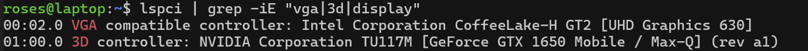
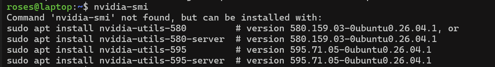
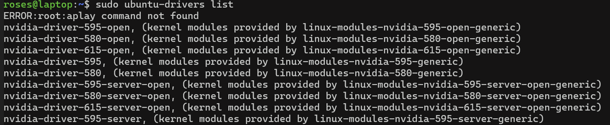
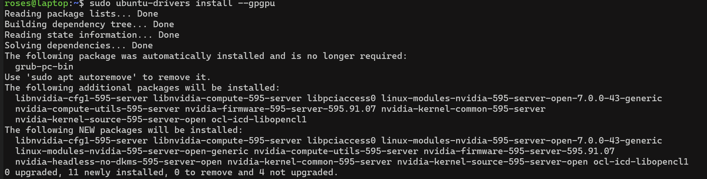
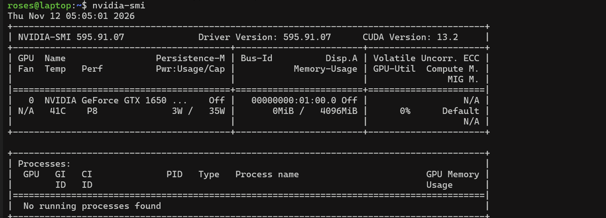

# Installing the NVIDIA Driver on Ubuntu Server

I'm a server test operator learning Linux. This was my first time installing a GPU driver from the command line.

How I installed and checked an NVIDIA GPU driver on a headless Ubuntu Server, with no desktop, no monitor, and everything done over SSH. This is the same basic check a test engineer runs when bringing up a new GPU server: confirm the hardware is detected, install the driver, and verify the GPU reports correctly.

## Setup

| Part | Details |
|------|---------|
| Machine | MSI GF63 Thin 9SC laptop running as a server |
| GPU | NVIDIA GeForce GTX 1650 Max-Q (4 GB) |
| OS | Ubuntu Server 26.04 LTS |
| Access | SSH from another laptop |

---

## Steps

**1. Connect to the server**
```
ssh roses@192.168.1.252
```

**2. Check that the server can see the GPU**
```
lspci | grep -iE "vga|3d|display"
```
This lists the graphics hardware. It showed the Intel UHD 630 and the NVIDIA GTX 1650, so the hardware was detected.



**3. Check if a driver is installed**
```
nvidia-smi
```
It said "command not found," which means there was no driver yet.



**4. Update the package list and see the recommended drivers**
```
sudo apt update
sudo ubuntu-drivers list
```



**5. Install the server driver**
```
sudo ubuntu-drivers install --gpgpu
sudo reboot
```
`--gpgpu` installs the version made for computing servers instead of the gaming version.



**6. Install the monitoring tool**

After the reboot, `nvidia-smi` still wasn't found. The server driver doesn't include the tool, so I checked which version was installed:
```
dpkg -l | grep nvidia
```
It was version 595, so I installed the matching tool:
```
sudo apt install nvidia-utils-595-server
```
The number has to match the driver version.

**7. Confirm it works**
```
nvidia-smi
```



---

## Reading the result

| Field | Value | What it means |
|-------|-------|---------------|
| Driver Version | 595.91.07 | The installed NVIDIA driver |
| CUDA Version | 13.2 | The highest CUDA version this driver supports |
| Temp | 41°C | GPU temperature (cool, since it's idle) |
| Perf | P8 | Power state. P8 is idle, P0 is full power |
| Pwr: Usage/Cap | 3W / 35W | Power being used now vs. the maximum |
| Bus-Id | 00000000:01:00.0 | The GPU's PCIe address (matches `lspci`) |
| Memory-Usage | 0MiB / 4096MiB | GPU memory used vs. total |
| GPU-Util | 0% | How busy the GPU is |
| Persistence-M | Off | Usually turned On in real servers so the driver stays loaded |

---

## Problem I ran into

**`nvidia-smi` was missing after installing the driver.**
`ubuntu-drivers install --gpgpu` installs the driver but not the `nvidia-smi` tool. I fixed it by finding the driver version with `dpkg -l | grep nvidia` and installing the matching `nvidia-utils-595-server` package.

---

## What's next

- [ ] Run a GPU stress test and watch temperature and power climb in `nvidia-smi`
- [ ] Turn on persistence mode (`sudo nvidia-smi -pm 1`)
- [ ] Log GPU stats over time (`nvidia-smi --query-gpu=temperature.gpu,power.draw,utilization.gpu --format=csv -l 5`)
